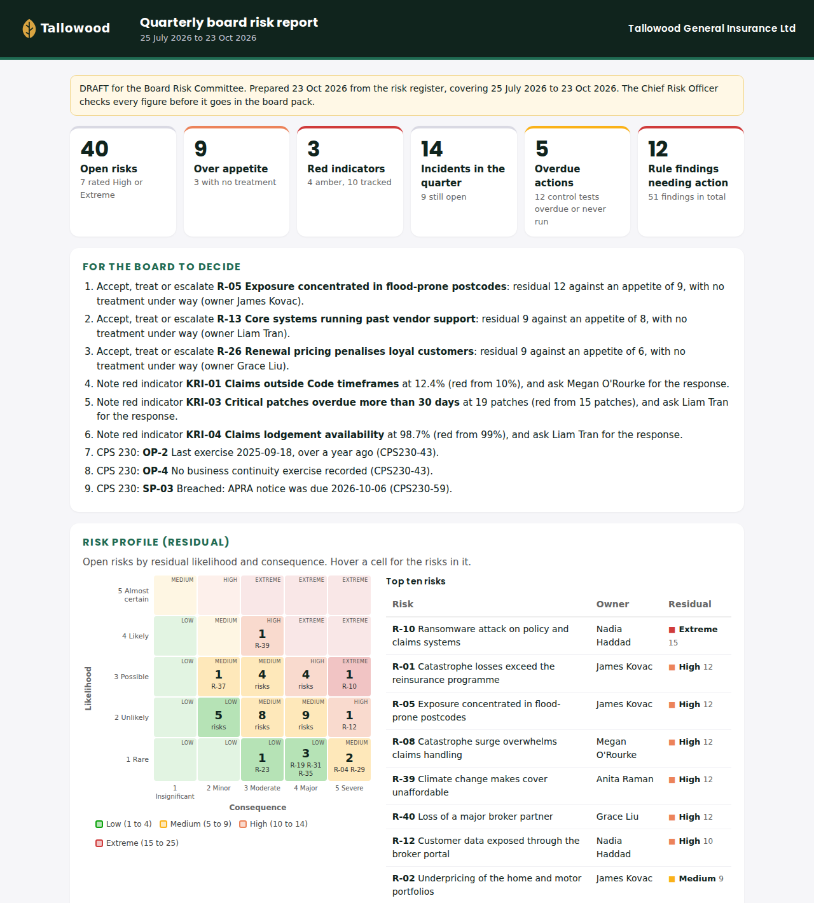

# The Protecht ERM demo

What a firm paying for Protecht ERM gets if it runs the same registers as a database plus Claude Code. Fifteen minutes, six questions, one fictional insurer.

**Tallowood General Insurance Ltd** is made up: an APRA-regulated Australian general insurer with 40 risks, 60 controls, 30 compliance obligations, 15 incidents, 10 key risk indicators, 5 critical operations and 10 service providers. Its people and providers are made up too. Dates are relative to the day you load it, so the overdue tests, this month's breaches and the running APRA clocks are always live.



[Full page screenshot](demo/board-report.png) · [The rendered report](demo/board-report.html) · [Every answer, captured](demo/answers.md)

## Run it

```bash
npm install
npm run demo:insurer
DATA_DIR=.data/insurer BRAND_FILE=demo/insurer/brand.json claude
```

`npm run demo:insurer` loads the insurer into its own embedded database in `.data/insurer`. It never touches `DATABASE_URL` or the Tasman demo, and running it twice changes nothing. On Windows PowerShell, set `$env:DATA_DIR=".data/insurer"` and `$env:BRAND_FILE="demo/insurer/brand.json"` before `claude`.

## Coverage: Protecht ERM modules

Built from the published Camms rebuild. Protecht's registers have the same shape as Camms', so the gaps were new tables in the same database, not a new product. That is why this lives in the same repo.

| Protecht ERM module | Status | What is here |
|---|---|---|
| Risk register | Covered | Inherent and residual ratings on your own 5 by 5 matrix, appetite per category, reviews with history, heat map, movement, stale ratings: `/risks`, `/risk`, `/heat-map`, `/appetite`, `/movement`, `/stale-ratings` |
| Controls and testing | Covered | Controls per risk, test cycles, results with evidence, gaps: `/controls-due`, `/test-control`, `/control-gaps` |
| Compliance obligations | Covered | Obligations register with source, attestation cycles and breaches: `/obligations-due`, `/attest` |
| Incidents | Covered, import built | Incident register with the CPS 230 24 and 72 hour clocks, the NZ and AU privacy clocks, actions and draft notices. New: import from a Protecht incident register export: `/log-incident`, `/incidents`, `/draft-notification`, `/import` |
| Key risk indicators | Built | Indicators with amber and red thresholds (higher or lower is worse), readings, status, trend, breaches this month, late readings, linked to a risk and a critical operation: `/indicators`, `/indicator-breaches`, `/add-indicator`, `/record-reading` |
| Internal audit | Built: findings | Audit findings register with rating, owner, due date and the risk and control it touches; overdue findings raise a rule: `/audit-findings`, `/add-finding`, `/close-finding`. Not built: the audit universe, the annual audit plan and workpapers |
| Operational resilience (CPS 230) | Covered, pack built | Critical operations with all three para 38 tolerance levels (minimum service level is now checked), exercises, BCP reviews, material providers and APRA notices. New: a CPS 230 gaps pack in one command, and a provider review rule: `/resilience`, `/cps230-gaps` |
| Board reporting | Built | A branded quarterly board risk report, as an HTML page for the board pack, alongside the Markdown committee report: `/board-report`, `/risk-report` |
| Switching | Built | Import from Protecht-style CSV exports of the risk and incident registers, with dry run, repeat safety and column mapping ([docs/replace-protecht.md](replace-protecht.md)) |

Not built, and why:

- Workflow screens, approvals, email alerts and staff forms. The operator asks Claude Code; anything that sends or lodges is drafted to `drafts/` and a person sends it.
- Risk and control self-assessment campaigns and questionnaires sent to staff.
- User roles and permissions inside the app. Use Postgres or Supabase roles on the database if you need them.
- Imports for controls, KRIs, obligations and audit findings, and the Protecht API or SFTP feeds. The tables are here; each import is a short job in the same pattern.

## The demo script

Ask these in order, in plain language. Each one runs one command; `npm test` checks every answer against the seeded data, and [docs/demo/answers.md](demo/answers.md) has the output from a fresh load.

### 1. Log an incident

> The claims payment run to Norvale failed today, about 900 payments did not go out. We knew at 2:45pm Sydney time. Daniel says the impact is material.

Claude says the time back in UTC (Sydney is UTC+11 in daylight saving) and asks which critical operation and risk it touches before recording it. Then it runs `/log-incident`. What to point out: the 72 hour APRA clock under CPS 230 para 33 starts on its own, and `/incidents` shows it next to the hosting outage whose 24 hour clock is already running. Claude does not decide materiality; Daniel did, and the record says so.

### 2. Which control tests are overdue?

`/controls-due` with a zero day window. **Answer:** 12 controls. 8 overdue, worst first: C-13 (catastrophe surge staffing, 35 days), C-08, C-48, C-21, C-14, C-03, C-33, C-53. 4 never tested: C-06, C-22, C-26, C-40.

### 3. Which indicators breached this month?

`/indicator-breaches`. **Answer:** 3 red: KRI-01 claims outside Code timeframes (12.4% against a red line of 10%), KRI-03 critical patches overdue (19 against 15), KRI-04 claims lodgement availability (98.7% against 99%). 3 amber: KRI-02 phishing click rate, KRI-08 claims staff turnover, KRI-10 catastrophe reinsurance used.

### 4. Where are our CPS 230 gaps?

`/cps230-gaps`. **Answer:** 4 of 5 critical operations and 4 of 8 material providers have a gap. Needs action now: OP-2 Claims lodgement exercise over a year old, OP-4 Catastrophe response never exercised, SP-03 Fenmoor Contact Centres agreement changed and the APRA notice is past its 20 business days (para 59). Also: OP-4 has no data loss tolerance and OP-5 no minimum service level (para 38), OP-3's BCP review is over a year old (para 45), SP-01 has an APRA notice coming due, and SP-02 and SP-06 have not been reviewed in a year.

### 5. Write the quarterly board risk report

`/board-report`. It writes one HTML page to `drafts/` in Tallowood's colours and logo: the decisions for the board (three risks over appetite with no treatment, three red indicators, three CPS 230 breaches), the heat map, risks over appetite, indicators with their recent readings, rating movement, incidents with their APRA notice status, CPS 230, control assurance, compliance and audit findings. Print it to PDF from the browser for the board pack.

### 6. Bring the Protecht export across

> Our marine and travel book is still in Protecht. Here is the risk register export: try it first.

`/import` with `fixtures/protecht-risks.csv` as a dry run (6 risks, 1 with no residual rating), then for real, then `fixtures/protecht-incidents.csv` with `--offset=+10:00` (5 incidents, each linked to its risk). `/compliance` then lists the 6 imported risks as drafts waiting for a person to confirm their ratings and owners. That is the switching story: the history comes across, nothing is invented, and a person signs off what changed.

## Questions a Protecht customer will ask

- **Where is the front end?** There isn't one to maintain. The register is plain Postgres; the board report and views are HTML pages; the operator asks in plain language. See [why-no-front-end.md](why-no-front-end.md).
- **Can we keep our matrix, categories and appetite?** Yes: `/customise` and `/add-category`. The demo uses a standard 5 by 5.
- **Is it checking CPS 230 for us?** It checks the records against the paragraphs cited in [compliance.md](compliance.md). It does not decide materiality, serious harm or appetite. A responsible person does, and the record shows who.
